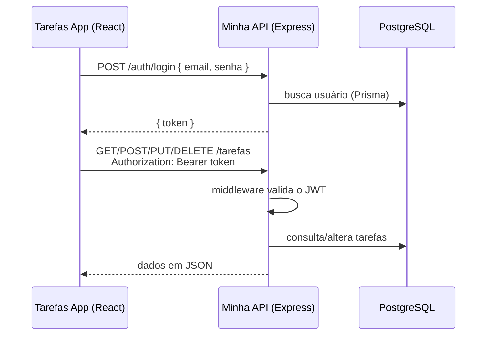

<h1 align="center">✅ Tarefas App</h1>

<p align="center">
  Gerenciador de tarefas com login, feito em React + Vite e integrado a uma API REST própria.
</p>

<p align="center">
  
  
  
  
</p>

---

## 📌 Sobre o projeto

Aplicação full-stack dividida em **dois repositórios**:

| Parte | Repositório | Tecnologias |
|---|---|---|
| 🖥️ **Front-end** (este) | [tarefas-app](https://github.com/Joaofg09/tarefas-app) | React, Vite, React Router, Axios |
| ⚙️ **Back-end** | [Minha-api](https://github.com/Joaofg09/Minha-api) | Node.js, Express, Prisma, PostgreSQL, JWT |

O usuário cria uma conta, faz login e gerencia suas tarefas. O front-end guarda o token JWT devolvido pela API e o envia automaticamente em todas as requisições protegidas.

## ✨ Funcionalidades

- 📝 **Cadastro** de conta com e-mail e senha
- 🔐 **Login** com autenticação JWT
- ➕ **Criar** tarefas
- ☑️ **Marcar e desmarcar** tarefas como concluídas (com texto riscado)
- 🗑️ **Excluir** tarefas
- 📊 **Contador** de tarefas concluídas ("2 de 5 concluídas")
- 🚪 **Logout** e redirecionamento automático para o login quando o token não existe ou expira

## 🧠 Como funciona



- `src/services/api.js` cria uma instância do **Axios** com a URL base vinda de `VITE_API_URL` e um **interceptor** que injeta o cabeçalho `Authorization: Bearer <token>` em toda requisição.
- As rotas `/tarefas` da API são protegidas por um middleware que valida o token.

## 📁 Estrutura

```
src/
├── pages/
│   ├── Login.jsx      # Formulário de login
│   ├── Cadastro.jsx   # Criação de conta
│   └── Tarefas.jsx    # Lista, criação, conclusão e exclusão de tarefas
├── services/
│   └── api.js         # Axios + interceptor do token JWT
├── App.jsx            # Rotas (/, /cadastro, /tarefas)
└── main.jsx
```

## 🚀 Como rodar

### Pré-requisitos
- [Node.js](https://nodejs.org/) 18 ou superior
- A [Minha-api](https://github.com/Joaofg09/Minha-api) rodando (por padrão em `http://localhost:3000`)

### Passo a passo

```bash
# 1. Clone o repositório
git clone https://github.com/Joaofg09/tarefas-app.git
cd tarefas-app

# 2. Instale as dependências
npm install

# 3. Crie o arquivo .env na raiz apontando para a API
echo "VITE_API_URL=http://localhost:3000" > .env

# 4. Inicie o projeto
npm run dev
```

Acesse **http://localhost:5173**, crie uma conta e comece a adicionar tarefas.

### Variáveis de ambiente

| Variável | Descrição | Exemplo |
|---|---|---|
| `VITE_API_URL` | URL base da API | `http://localhost:3000` |

### Scripts

| Comando | O que faz |
|---|---|
| `npm run dev` | Servidor de desenvolvimento |
| `npm run build` | Build de produção na pasta `dist/` |
| `npm run preview` | Pré-visualiza o build de produção |
| `npm run lint` | Verifica o código com ESLint |

---

<p align="center">
  Feito por <a href="https://github.com/Joaofg09">João Pedro</a>
</p>
